# 04 — Request Flows

Every request the wallet handles, traced through the code: validation, idempotency, transactions, row locks, the ledger write, and every way it can fail. Each flow has a sequence diagram whose participants are the code layers, followed by a table of the same numbered steps with links to the exact lines.

The flows share one example story, so the numbers connect. Alice tops up ₹100, sends Bob ₹50 and withdraws ₹30. Bob refunds ₹20, then the ₹30 withdrawal is reversed. After every flow, the wallets still add up to the cash pool.

Amounts are in paise (`10000` = ₹100). Line numbers match the code as of milestone 4.

## How to read the diagrams

| In the diagram | Meaning |
|---|---|
| Number on an arrow | The row with the same number in the step table below the diagram |
| Solid arrow | A Java call or an SQL statement |
| Dashed arrow | A return value |
| Arrow ending in **x** | A failure path |
| Shaded box with a "Tx" note | Everything inside runs in one database transaction |
| Bar on a participant's lifeline (activation) | Row locks held, from the `FOR UPDATE` until COMMIT |

| Participant | Classes | Its job |
|---|---|---|
| Client | curl, tests (`ApiClient`) | Sends the request with an `Idempotency-Key` header |
| API | `WalletController`, `TransferController`, `JournalController`, `RequestValidator`, `ApiExceptionHandler`, `IdempotentResponses` | HTTP in and out, input checks, exception → status code |
| Idempotency | `IdempotencyService`, `IdempotencyRepository`, `RequestHasher` | Runs each key at most once; owns the transaction boundaries Tx1, Tx2, Tx3 |
| Wallet ops | `WalletOperations`, `CorrectionOperations` | Turns a business action into a journal recipe; business rules |
| Ledger | `LedgerService`, `PessimisticLocking` / `OptimisticLocking`, `AccountRepository`, `LedgerRepository` | The only writer of balances, journals and postings |
| Postgres | tables, CHECK constraints, triggers, unique indexes | Row locks, MVCC snapshots, and the last line of defence |

## One pipeline, five recipes

Top-up, transfer, withdraw, refund and reversal all travel the same eleven steps. What changes is the journal recipe (which accounts get + and −) and a few business checks.

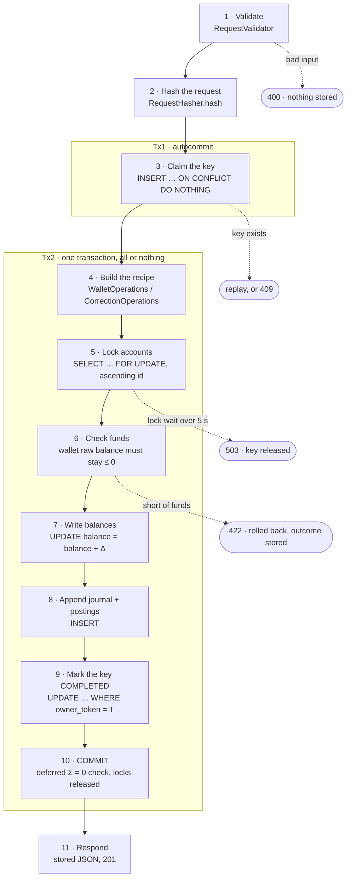

Steps 4–10 are one transaction: if anything fails inside it, Postgres rolls all of it back. Step 9 commits together with the money, so a retry can never move money twice.

| Operation | Postings written (debit +, credit −) | Extra checks before posting | Recipe |
|---|---|---|---|
| Top-up | Pool **+x**, Wallet **−x** | wallet exists and is a user wallet | [WalletOperations.java:40](../src/main/java/com/hirdesh/wallet/wallet/WalletOperations.java#L40) |
| Transfer | Sender **+x**, Receiver **−x** | sender ≠ receiver, both wallets exist, sender has funds | [WalletOperations.java:54](../src/main/java/com/hirdesh/wallet/wallet/WalletOperations.java#L54) |
| Withdraw | Wallet **+x**, Pool **−x** | wallet has funds | [WalletOperations.java:47](../src/main/java/com/hirdesh/wallet/wallet/WalletOperations.java#L47) |
| Refund | Receiver **+r**, Sender **−r** | lock original journal, original is a transfer, refunds so far + r ≤ original, receiver has funds | [CorrectionOperations.java:44](../src/main/java/com/hirdesh/wallet/wallet/CorrectionOperations.java#L44) |
| Reversal | Original postings, signs flipped | lock original journal, original is a top-up or withdrawal, not reversed before, wallet has funds | [CorrectionOperations.java:72](../src/main/java/com/hirdesh/wallet/wallet/CorrectionOperations.java#L72) |

A wallet is money the platform *owes*, so its raw balance is negative when the user has money: `−10000` in the database is ₹100 in the app ([Account.java:11](../src/main/java/com/hirdesh/wallet/account/Account.java#L11)).

## Flows

- [Top-up](#top-up): Alice adds ₹100
- [Transfer](#transfer): Alice sends Bob ₹50
- [Withdraw](#withdraw): Alice cashes out ₹30
- [Refund](#refund): Bob returns ₹20 of the ₹50 transfer
- [Reversal](#reversal): Alice's ₹30 bank payout bounced
- [Idempotency](#idempotency): one key, at most one money movement
- [Errors](#errors): what fails, where, and what is left behind
- [Concurrency](#concurrency): two transfers hit the same wallet
- [Reads and wallet creation](#reads-and-wallet-creation)

---


## Top-up

**Alice adds ₹100.** Money enters the system from outside (a card or UPI payment, simulated here). The cash pool goes up and Alice's wallet goes up. This is the full walkthrough; the other sections reuse most of these steps.

- **Endpoint:** `POST /api/v1/wallets/{walletId}/top-ups`
- **Request fingerprint:** `TOP_UP | walletId | amount`
- **Rows locked:** `cash pool (id 1), then wallet (id 2)`
- **Journal written:** `TOP_UP: pool +10000, wallet −10000`

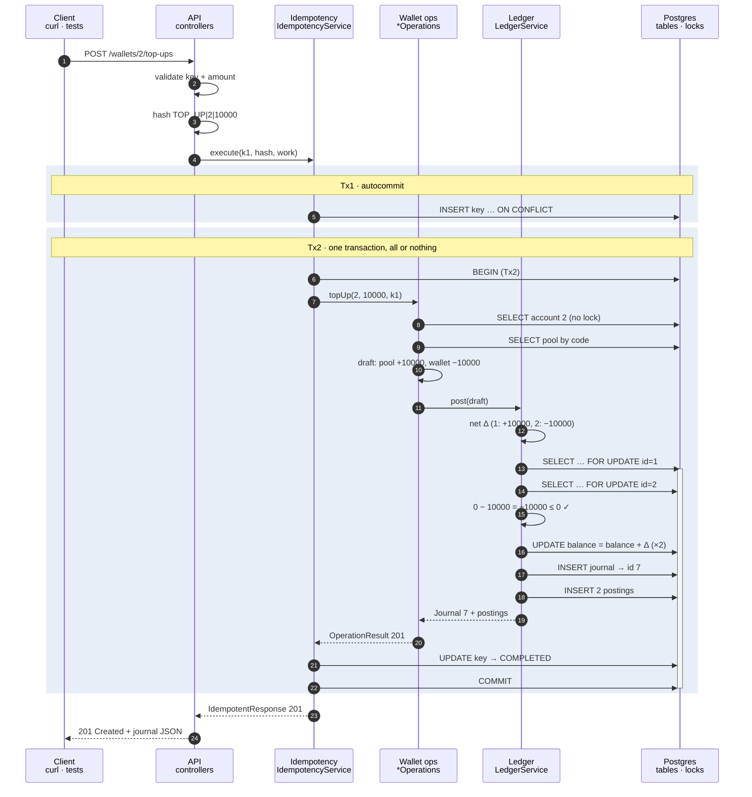

*Tx1 claims the key on its own. Tx2 holds both row locks from the first FOR UPDATE until COMMIT, and the key is marked COMPLETED inside the same transaction as the money.* Activation bars: pool + Alice locked (steps 13–22).

| # | Step | What happens | Code | Can fail with |
|---|---|---|---|---|
| 1 | Client sends the top-up | Body `{"amount":10000}` (₹100 in paise) with the header `Idempotency-Key: k1`. Spring MVC routes it to `WalletController.topUp`. | [WalletController.java:71](../src/main/java/com/hirdesh/wallet/api/WalletController.java#L71) |  |
| 2 | Validate the input | The key must be 1–100 characters. The amount must be present, above 0 and at most ₹1,00,000. A failure throws before anything touches the database, so the key is never claimed and stays usable. | [RequestValidator.java:41](../src/main/java/com/hirdesh/wallet/api/RequestValidator.java#L41)<br>[RequestValidator.java:20](../src/main/java/com/hirdesh/wallet/api/RequestValidator.java#L20)<br>[application.yml:29](../src/main/resources/application.yml#L29) | `400 IDEMPOTENCY_KEY_MISSING` no header<br>`400 VALIDATION_FAILED` amount missing, ≤ 0 or too large |
| 3 | Fingerprint the request | SHA-256 of the operation and its parsed parameters. A later request with the same key must produce the same fingerprint; otherwise it is a different request reusing the key. | [RequestHasher.java:22](../src/main/java/com/hirdesh/wallet/idempotency/RequestHasher.java#L22) |  |
| 4 | Hand over to idempotency | `work` is a lambda that will call `ops.topUp(2, 10000, k1)`. IdempotencyService decides whether it runs at all. | [IdempotencyService.java:59](../src/main/java/com/hirdesh/wallet/idempotency/IdempotencyService.java#L59) |  |
| 5 | Tx1: claim the key | One autocommit statement. The primary key on `idempotency_keys.key` lets exactly one request insert it. The row is IN_PROGRESS, owned by a random token T, with a 30-second lease. If the insert does nothing, the key already exists: see [Idempotency](#idempotency). | [IdempotencyService.java:131](../src/main/java/com/hirdesh/wallet/idempotency/IdempotencyService.java#L131)<br>[IdempotencyRepository.java:23](../src/main/java/com/hirdesh/wallet/idempotency/IdempotencyRepository.java#L23)<br>[application.yml:26](../src/main/resources/application.yml#L26) | `replay or 409` k1 already exists |
| 6 | Tx2 begins | `TransactionTemplate.execute` borrows one connection from the pool (at most 10) and opens a transaction. Everything until COMMIT is all or nothing. | [IdempotencyService.java:93](../src/main/java/com/hirdesh/wallet/idempotency/IdempotencyService.java#L93)<br>[IdempotencyService.java:96](../src/main/java/com/hirdesh/wallet/idempotency/IdempotencyService.java#L96)<br>[application.yml:11](../src/main/resources/application.yml#L11) |  |
| 7 | Run the work | The lambda calls the top-up recipe inside Tx2. | [IdempotencyService.java:97](../src/main/java/com/hirdesh/wallet/idempotency/IdempotencyService.java#L97)<br>[WalletOperations.java:40](../src/main/java/com/hirdesh/wallet/wallet/WalletOperations.java#L40) |  |
| 8 | Is account 2 a user wallet? | A plain read. It must exist and be a USER_WALLET, which also stops anyone passing the cash pool's id as a wallet. No lock is needed because an account's type never changes. | [WalletOperations.java:68](../src/main/java/com/hirdesh/wallet/wallet/WalletOperations.java#L68)<br>[AccountRepository.java:31](../src/main/java/com/hirdesh/wallet/account/AccountRepository.java#L31) | `404 WALLET_NOT_FOUND` missing, or it is the pool |
| 9 | Find the cash pool | Looks up the system account `CASH_POOL` (id 1). | [WalletOperations.java:75](../src/main/java/com/hirdesh/wallet/wallet/WalletOperations.java#L75)<br>[AccountRepository.java:38](../src/main/java/com/hirdesh/wallet/account/AccountRepository.java#L38) |  |
| 10 | Build the journal recipe | Money enters from outside: the pool (an asset) is debited `+10000` and the wallet (a liability) is credited `−10000`. The `JournalDraft` constructor rejects anything that isn't valid double-entry: amount ≤ 0, fewer than 2 postings, a zero posting, or postings that don't sum to 0. That would be a bug in a recipe, so it surfaces as a 500. | [WalletOperations.java:63](../src/main/java/com/hirdesh/wallet/wallet/WalletOperations.java#L63)<br>[JournalDraft.java:18](../src/main/java/com/hirdesh/wallet/ledger/JournalDraft.java#L18) | `500 INTERNAL_ERROR` invalid draft = programming bug |
| 11 | The ledger takes over | The single write path for money. It first checks that a transaction is active, because the locks it takes must live until Tx2 commits. | [LedgerService.java:35](../src/main/java/com/hirdesh/wallet/ledger/LedgerService.java#L35)<br>[LedgerService.java:36](../src/main/java/com/hirdesh/wallet/ledger/LedgerService.java#L36) |  |
| 12 | Net change per account | Postings are summed per account into a `TreeMap`. Its keys are sorted by account id, and that order is the global lock order. | [LedgerService.java:43](../src/main/java/com/hirdesh/wallet/ledger/LedgerService.java#L43) |  |
| 13 | Lock the cash pool row | Pessimistic locking (ADR-003). The row stays locked until Tx2 ends. Another transaction that wants this row waits here, while plain reads are never blocked (MVCC). After 5 seconds of waiting Postgres gives up with SQLState 55P03. | [PessimisticLocking.java:25](../src/main/java/com/hirdesh/wallet/ledger/locking/PessimisticLocking.java#L25)<br>[AccountRepository.java:49](../src/main/java/com/hirdesh/wallet/account/AccountRepository.java#L49)<br>[application.yml:14](../src/main/resources/application.yml#L14) | `503 TRY_AGAIN` waited more than 5s for the lock |
| 14 | Lock Alice's wallet row | Second, because ids are locked in ascending order. Everyone follows the same order, so two transactions can never each hold the row the other one needs. | [PessimisticLocking.java:28](../src/main/java/com/hirdesh/wallet/ledger/locking/PessimisticLocking.java#L28) |  |
| 15 | Check funds | For each user wallet: new raw balance = old + delta. Above 0 would mean the user owes us money. A top-up only adds money, so it passes. The check is safe only because we hold the locks: nobody can change these balances until we commit. | [LedgerService.java:54](../src/main/java/com/hirdesh/wallet/ledger/LedgerService.java#L54) | `422 INSUFFICIENT_FUNDS` would overdraw (impossible for a top-up) |
| 16 | Write the new balances | Relative updates, one per account. CHECK constraints run on every update: a wallet's raw balance can never go above 0 and the pool's can never go below 0, even if the Java code had a bug. | [LedgerService.java:60](../src/main/java/com/hirdesh/wallet/ledger/LedgerService.java#L60)<br>[PessimisticLocking.java:34](../src/main/java/com/hirdesh/wallet/ledger/locking/PessimisticLocking.java#L34)<br>[AccountRepository.java:57](../src/main/java/com/hirdesh/wallet/account/AccountRepository.java#L57)<br>[V1__accounts.sql:15](../src/main/resources/db/migration/V1__accounts.sql#L15) |  |
| 17 | Append the journal | One row for the business event. A deferred trigger is queued to check this journal at COMMIT. | [LedgerService.java:63](../src/main/java/com/hirdesh/wallet/ledger/LedgerService.java#L63)<br>[LedgerRepository.java:22](../src/main/java/com/hirdesh/wallet/ledger/LedgerRepository.java#L22)<br>[V3__ledger_guards.sql:38](../src/main/resources/db/migration/V3__ledger_guards.sql#L38) |  |
| 18 | Append the postings | One line per account. Between these two inserts the journal is briefly unbalanced, which is why the balance check waits for COMMIT instead of running per row. | [LedgerService.java:65](../src/main/java/com/hirdesh/wallet/ledger/LedgerService.java#L65)<br>[LedgerRepository.java:35](../src/main/java/com/hirdesh/wallet/ledger/LedgerRepository.java#L35)<br>[V3__ledger_guards.sql:42](../src/main/resources/db/migration/V3__ledger_guards.sql#L42) |  |
| 19 | Return the journal | Read back with its postings. | [LedgerService.java:69](../src/main/java/com/hirdesh/wallet/ledger/LedgerService.java#L69)<br>[LedgerRepository.java:43](../src/main/java/com/hirdesh/wallet/ledger/LedgerRepository.java#L43) |  |
| 20 | Wrap the result | The controller's lambda turns the journal into a `JournalResponse` body with status 201. | [WalletController.java:92](../src/main/java/com/hirdesh/wallet/api/WalletController.java#L92) |  |
| 21 | Mark the key done, if we still own it | Stores the status and the exact JSON body. `WHERE owner_token = T` is the fencing check: if our lease expired and another request took the key over, this matches 0 rows, we throw, and Tx2 rolls back, money included. | [IdempotencyService.java:99](../src/main/java/com/hirdesh/wallet/idempotency/IdempotencyService.java#L99)<br>[IdempotencyRepository.java:67](../src/main/java/com/hirdesh/wallet/idempotency/IdempotencyRepository.java#L67) | `503 TRY_AGAIN` lost ownership (0 rows) |
| 22 | Commit Tx2 | The deferred triggers run now: journal 7 must sum to 0 and have at least 2 postings. Then the balances, the journal, the postings and the COMPLETED key become visible to everyone at the same instant, and both row locks are released. | [V3__ledger_guards.sql:18](../src/main/resources/db/migration/V3__ledger_guards.sql#L18) | `500 INTERNAL_ERROR` journal unbalanced (only if a recipe had a bug) |
| 23 | Back to the controller | Carries the same JSON string that step 21 stored. |  |  |
| 24 | Respond | The stored JSON is sent as-is, so a retry later gets byte-identical output plus the header `Idempotent-Replayed: true`. | [IdempotentResponses.java:16](../src/main/java/com/hirdesh/wallet/api/IdempotentResponses.java#L16) |  |

<details>
<summary>SQL run in this flow</summary>

**Step 5: Tx1: claim the key**

```sql
INSERT INTO idempotency_keys (key, request_hash, status, owner_token, locked_until)
VALUES ('k1', :hash, 'IN_PROGRESS', :T, now() + interval '30 seconds')
ON CONFLICT (key) DO NOTHING;
```

**Step 13: Lock the cash pool row**

```sql
SELECT id, type, user_id, code, balance, version
FROM accounts WHERE id = 1 FOR UPDATE;
```

**Step 16: Write the new balances**

```sql
UPDATE accounts SET balance = balance + 10000 WHERE id = 1;
UPDATE accounts SET balance = balance - 10000 WHERE id = 2;
```

**Step 17: Append the journal**

```sql
INSERT INTO journals (type, amount, reference_journal_id, idempotency_key)
VALUES ('TOP_UP', 10000, NULL, 'k1') RETURNING id;   -- 7
```

**Step 18: Append the postings**

```sql
INSERT INTO postings (journal_id, account_id, amount) VALUES (7, 1,  10000);
INSERT INTO postings (journal_id, account_id, amount) VALUES (7, 2, -10000);
```

**Step 21: Mark the key done, if we still own it**

```sql
UPDATE idempotency_keys SET status = 'COMPLETED', response_status = 201,
       response_body = '{…}', journal_id = 7, owner_token = NULL, locked_until = NULL
WHERE key = 'k1' AND status = 'IN_PROGRESS' AND owner_token = :T;
```

</details>

### Database before and after

| Row | Before | After |
|---|---|---|
| accounts · id 1 CASH_POOL | 0 | 10000 |
| accounts · id 2 alice | 0 | −10000 (the app shows ₹100) |
| journals | — | + id 7 · TOP_UP · 10000 · key k1 |
| postings | — | + (7, account 1, +10000) · (7, account 2, −10000) |
| idempotency_keys · k1 | — | COMPLETED · 201 · journal 7 · stored JSON |

A retry with the same key and body runs steps 1–5 only: the INSERT finds k1 COMPLETED with the same fingerprint, and the stored 201 goes back. No transaction, no locks, no money moved.

---

## Transfer

**Alice sends Bob ₹50.** Money moves between two users. The cash pool isn't involved. This is the flow where the funds check and the lock order matter most.

- **Endpoint:** `POST /api/v1/transfers`
- **Request fingerprint:** `TRANSFER | from | to | amount`
- **Rows locked:** `Alice (id 2), then Bob (id 3)`
- **Journal written:** `TRANSFER: Alice +5000, Bob −5000`

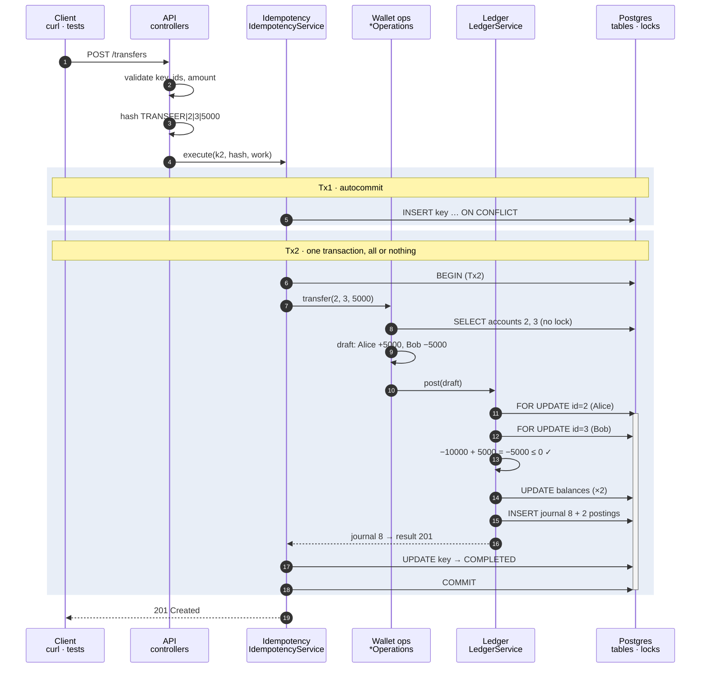

*Same pipeline as the top-up; only the recipe and the locked rows differ. Both wallets stay locked until COMMIT, so no other transfer can read a stale balance for either of them.* Activation bars: Alice + Bob locked (steps 11–18).

| # | Step | What happens | Code | Can fail with |
|---|---|---|---|---|
| 1 | Client sends the transfer | Body `{"fromWalletId":2,"toWalletId":3,"amount":5000}` with `Idempotency-Key: k2`. | [TransferController.java:35](../src/main/java/com/hirdesh/wallet/api/TransferController.java#L35) |  |
| 2 | Validate | Key and amount as for a top-up, plus both ids present and sender ≠ receiver (BR-4). | [RequestValidator.java:33](../src/main/java/com/hirdesh/wallet/api/RequestValidator.java#L33)<br>[TransferController.java:41](../src/main/java/com/hirdesh/wallet/api/TransferController.java#L41) | `400 VALIDATION_FAILED` missing id, bad amount, or a self-transfer |
| 3 | Fingerprint | Sender, receiver and amount are all part of it, so reusing k2 for a different amount or receiver is caught. | [RequestHasher.java:22](../src/main/java/com/hirdesh/wallet/idempotency/RequestHasher.java#L22) |  |
| 4 | Hand over to idempotency |  | [IdempotencyService.java:59](../src/main/java/com/hirdesh/wallet/idempotency/IdempotencyService.java#L59) |  |
| 5 | Tx1: claim k2 | Same statement as the top-up. | [IdempotencyRepository.java:23](../src/main/java/com/hirdesh/wallet/idempotency/IdempotencyRepository.java#L23) |  |
| 6 | Tx2 begins |  | [IdempotencyService.java:96](../src/main/java/com/hirdesh/wallet/idempotency/IdempotencyService.java#L96) |  |
| 7 | Run the transfer recipe |  | [WalletOperations.java:54](../src/main/java/com/hirdesh/wallet/wallet/WalletOperations.java#L54) |  |
| 8 | Both must be user wallets | Two plain reads. Either one missing, or either one being the pool, stops the transfer. | [WalletOperations.java:68](../src/main/java/com/hirdesh/wallet/wallet/WalletOperations.java#L68) | `404 WALLET_NOT_FOUND` unknown wallet or the pool |
| 9 | Build the recipe | The sender is debited `+5000` (the platform owes Alice less) and the receiver is credited `−5000` (it owes Bob more). Two postings, sum 0. | [WalletOperations.java:63](../src/main/java/com/hirdesh/wallet/wallet/WalletOperations.java#L63) |  |
| 10 | Ledger takes over |  | [LedgerService.java:35](../src/main/java/com/hirdesh/wallet/ledger/LedgerService.java#L35) |  |
| 11 | Lock the lower id first | Ascending id order. A Bob→Alice transfer running at the same moment also starts with id 2, so it waits here holding nothing. Neither transaction can hold a row the other needs, so a deadlock is impossible (S-32). | [PessimisticLocking.java:25](../src/main/java/com/hirdesh/wallet/ledger/locking/PessimisticLocking.java#L25)<br>[AccountRepository.java:49](../src/main/java/com/hirdesh/wallet/account/AccountRepository.java#L49) | `503 TRY_AGAIN` waited more than 5s |
| 12 | Lock Bob's row |  | [PessimisticLocking.java:28](../src/main/java/com/hirdesh/wallet/ledger/locking/PessimisticLocking.java#L28) |  |
| 13 | Can Alice pay? | Alice's raw balance is −10000 (₹100); afterwards −5000 (₹50). Sending ₹150 instead would give +5000, an overdraft: the ledger throws, Tx2 rolls back, and the 422 is stored for k2 (see [Errors](#errors)). | [LedgerService.java:54](../src/main/java/com/hirdesh/wallet/ledger/LedgerService.java#L54) | `422 INSUFFICIENT_FUNDS` Alice has less than the amount |
| 14 | Write both balances |  | [AccountRepository.java:57](../src/main/java/com/hirdesh/wallet/account/AccountRepository.java#L57) |  |
| 15 | Append journal and postings |  | [LedgerRepository.java:22](../src/main/java/com/hirdesh/wallet/ledger/LedgerRepository.java#L22)<br>[LedgerRepository.java:35](../src/main/java/com/hirdesh/wallet/ledger/LedgerRepository.java#L35) |  |
| 16 | Return through the recipe | Back through WalletOperations and the controller lambda as an `OperationResult`. | [WalletController.java:92](../src/main/java/com/hirdesh/wallet/api/WalletController.java#L92) |  |
| 17 | Mark k2 done (fencing check) |  | [IdempotencyRepository.java:67](../src/main/java/com/hirdesh/wallet/idempotency/IdempotencyRepository.java#L67) |  |
| 18 | Commit Tx2 | Deferred check on journal 8, then everything becomes visible together and both locks are released. A transfer that was waiting on Alice's row wakes up now and reads her new balance. |  |  |
| 19 | Respond | Through the controller, as the stored JSON. | [IdempotentResponses.java:16](../src/main/java/com/hirdesh/wallet/api/IdempotentResponses.java#L16) |  |

<details>
<summary>SQL run in this flow</summary>

**Step 14: Write both balances**

```sql
UPDATE accounts SET balance = balance + 5000 WHERE id = 2;
UPDATE accounts SET balance = balance - 5000 WHERE id = 3;
```

**Step 15: Append journal and postings**

```sql
INSERT INTO journals (type, amount, reference_journal_id, idempotency_key)
VALUES ('TRANSFER', 5000, NULL, 'k2') RETURNING id;   -- 8
INSERT INTO postings VALUES (…, 8, 2,  5000), (…, 8, 3, -5000);
```

</details>

### Database before and after

| Row | Before | After |
|---|---|---|
| accounts · id 1 CASH_POOL | 10000 | 10000 (unchanged) |
| accounts · id 2 alice | −10000 | −5000 (₹50) |
| accounts · id 3 bob | 0 | −5000 (₹50) |
| journals | — | + id 8 · TRANSFER · 5000 · key k2 |
| postings | — | + (8, account 2, +5000) · (8, account 3, −5000) |

Wallets still equal the pool: ₹50 + ₹50 = ₹100.

---

## Withdraw

**Alice cashes out ₹30.** Money leaves the system to Alice's bank account. Both the wallet and the cash pool go down. The bank payout is simulated and always succeeds in v1.

- **Endpoint:** `POST /api/v1/wallets/{walletId}/withdrawals`
- **Request fingerprint:** `WITHDRAW | walletId | amount`
- **Rows locked:** `cash pool (id 1), then wallet (id 2)`
- **Journal written:** `WITHDRAW: Alice +3000, pool −3000`

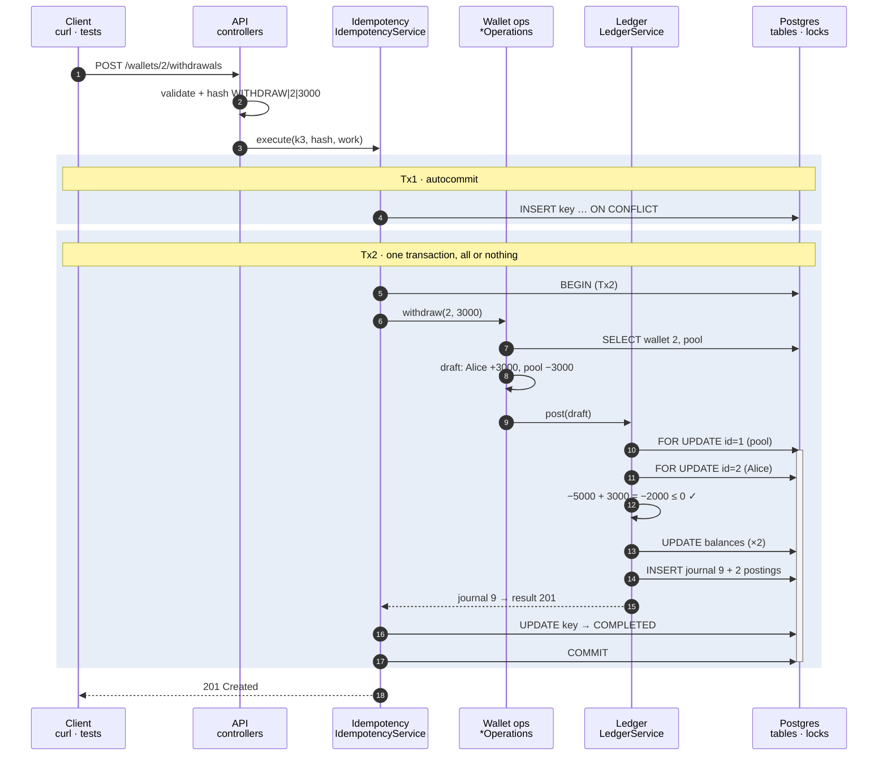

*The mirror image of a top-up. The pool has the lowest id, so it is always the first lock: every top-up and withdrawal in the system queues on that one row.* Activation bars: pool + Alice locked (steps 10–17).

| # | Step | What happens | Code | Can fail with |
|---|---|---|---|---|
| 1 | Client asks to withdraw | Body `{"amount":3000}` with `Idempotency-Key: k3`. | [WalletController.java:82](../src/main/java/com/hirdesh/wallet/api/WalletController.java#L82) |  |
| 2 | Validate and fingerprint |  | [RequestValidator.java:20](../src/main/java/com/hirdesh/wallet/api/RequestValidator.java#L20)<br>[RequestHasher.java:22](../src/main/java/com/hirdesh/wallet/idempotency/RequestHasher.java#L22) | `400 VALIDATION_FAILED` bad amount<br>`400 IDEMPOTENCY_KEY_MISSING` no header |
| 3 | Hand over to idempotency |  | [IdempotencyService.java:59](../src/main/java/com/hirdesh/wallet/idempotency/IdempotencyService.java#L59) |  |
| 4 | Tx1: claim k3 |  | [IdempotencyRepository.java:23](../src/main/java/com/hirdesh/wallet/idempotency/IdempotencyRepository.java#L23) |  |
| 5 | Tx2 begins |  | [IdempotencyService.java:96](../src/main/java/com/hirdesh/wallet/idempotency/IdempotencyService.java#L96) |  |
| 6 | Run the withdraw recipe |  | [WalletOperations.java:47](../src/main/java/com/hirdesh/wallet/wallet/WalletOperations.java#L47) |  |
| 7 | Find the wallet and the pool |  | [WalletOperations.java:68](../src/main/java/com/hirdesh/wallet/wallet/WalletOperations.java#L68)<br>[WalletOperations.java:75](../src/main/java/com/hirdesh/wallet/wallet/WalletOperations.java#L75) | `404 WALLET_NOT_FOUND` unknown wallet |
| 8 | Build the recipe | The wallet (a liability) goes down: debit `+3000`. The pool (an asset) goes down: credit `−3000`. A real system would hold the money in a pending state until the bank confirms; v1 assumes the payout always succeeds. | [WalletOperations.java:63](../src/main/java/com/hirdesh/wallet/wallet/WalletOperations.java#L63) |  |
| 9 | Ledger takes over |  | [LedgerService.java:35](../src/main/java/com/hirdesh/wallet/ledger/LedgerService.java#L35) |  |
| 10 | Lock the pool first | Lowest id, so always first. This is the hot row from ADR-003: all top-ups and withdrawals wait on it one at a time. Splitting the pool into several sub-accounts is the known fix if that ever becomes the bottleneck. | [PessimisticLocking.java:25](../src/main/java/com/hirdesh/wallet/ledger/locking/PessimisticLocking.java#L25) | `503 TRY_AGAIN` waited more than 5s |
| 11 | Lock Alice's row |  | [PessimisticLocking.java:28](../src/main/java/com/hirdesh/wallet/ledger/locking/PessimisticLocking.java#L28) |  |
| 12 | Does Alice have ₹30? | She has ₹50 (raw −5000). Afterwards ₹20 (raw −2000). Asking for ₹60 would give +1000, an overdraft. | [LedgerService.java:54](../src/main/java/com/hirdesh/wallet/ledger/LedgerService.java#L54) | `422 INSUFFICIENT_FUNDS` withdrawing more than the balance |
| 13 | Write both balances | The pool's CHECK (balance ≥ 0) also guards this update. | [AccountRepository.java:57](../src/main/java/com/hirdesh/wallet/account/AccountRepository.java#L57)<br>[V1__accounts.sql:16](../src/main/resources/db/migration/V1__accounts.sql#L16) |  |
| 14 | Append journal and postings |  | [LedgerRepository.java:22](../src/main/java/com/hirdesh/wallet/ledger/LedgerRepository.java#L22)<br>[LedgerRepository.java:35](../src/main/java/com/hirdesh/wallet/ledger/LedgerRepository.java#L35) |  |
| 15 | Return the result |  | [WalletController.java:92](../src/main/java/com/hirdesh/wallet/api/WalletController.java#L92) |  |
| 16 | Mark k3 done (fencing check) |  | [IdempotencyRepository.java:67](../src/main/java/com/hirdesh/wallet/idempotency/IdempotencyRepository.java#L67) |  |
| 17 | Commit Tx2 | Deferred check on journal 9; locks on the pool and Alice released. |  |  |
| 18 | Respond |  | [IdempotentResponses.java:16](../src/main/java/com/hirdesh/wallet/api/IdempotentResponses.java#L16) |  |

<details>
<summary>SQL run in this flow</summary>

**Step 13: Write both balances**

```sql
UPDATE accounts SET balance = balance - 3000 WHERE id = 1;
UPDATE accounts SET balance = balance + 3000 WHERE id = 2;
```

**Step 14: Append journal and postings**

```sql
INSERT INTO journals (type, amount, reference_journal_id, idempotency_key)
VALUES ('WITHDRAW', 3000, NULL, 'k3') RETURNING id;   -- 9
INSERT INTO postings VALUES (…, 9, 2, 3000), (…, 9, 1, -3000);
```

</details>

### Database before and after

| Row | Before | After |
|---|---|---|
| accounts · id 1 CASH_POOL | 10000 | 7000 |
| accounts · id 2 alice | −5000 | −2000 (₹20) |
| journals | — | + id 9 · WITHDRAW · 3000 · key k3 |
| postings | — | + (9, account 2, +3000) · (9, account 1, −3000) |

Check: Alice ₹20 + Bob ₹50 = ₹70 = the pool. Raw balances −2000 − 5000 + 7000 = 0.

---

## Refund

**Bob returns ₹20 of the ₹50 transfer.** A refund is a new journal that points back at the original transfer (journal 8). Nothing about journal 8 changes. Partial refunds are allowed, as long as all refunds together never exceed the original amount.

- **Endpoint:** `POST /api/v1/journals/{journalId}/refunds`
- **Request fingerprint:** `REFUND | journalId | amount`
- **Rows locked:** `journal 8, then Alice (2), then Bob (3)`
- **Journal written:** `REFUND ref 8: Bob +2000, Alice −2000`

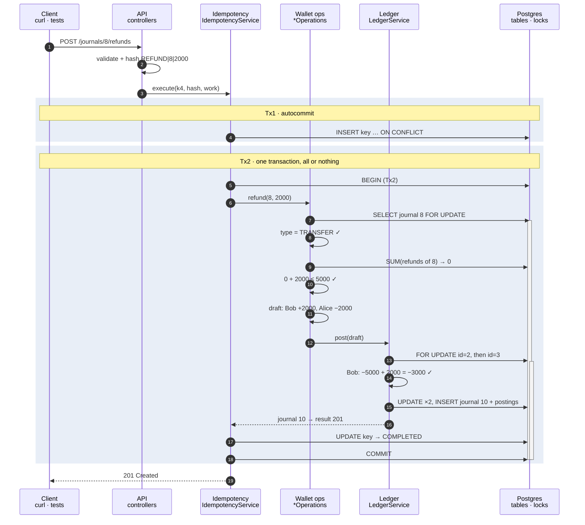

*Two locks with different jobs. The journal lock protects the "total refunded" rule, which is checked before the ledger runs; the account locks protect the balances. The order is always journal, then accounts.* Activation bars: journal 8 (steps 7–18); Alice + Bob (steps 13–18).

| # | Step | What happens | Code | Can fail with |
|---|---|---|---|---|
| 1 | Client asks for a refund | Body `{"amount":2000}` with `Idempotency-Key: k4`. Journal 8 is Alice's ₹50 transfer to Bob. | [JournalController.java:49](../src/main/java/com/hirdesh/wallet/api/JournalController.java#L49) |  |
| 2 | Validate and fingerprint |  | [RequestValidator.java:20](../src/main/java/com/hirdesh/wallet/api/RequestValidator.java#L20)<br>[RequestHasher.java:22](../src/main/java/com/hirdesh/wallet/idempotency/RequestHasher.java#L22) | `400 VALIDATION_FAILED` bad amount<br>`400 IDEMPOTENCY_KEY_MISSING` no header |
| 3 | Hand over to idempotency |  | [IdempotencyService.java:59](../src/main/java/com/hirdesh/wallet/idempotency/IdempotencyService.java#L59) |  |
| 4 | Tx1: claim k4 |  | [IdempotencyRepository.java:23](../src/main/java/com/hirdesh/wallet/idempotency/IdempotencyRepository.java#L23) |  |
| 5 | Tx2 begins |  | [IdempotencyService.java:96](../src/main/java/com/hirdesh/wallet/idempotency/IdempotencyService.java#L96) |  |
| 6 | Run the refund |  | [CorrectionOperations.java:44](../src/main/java/com/hirdesh/wallet/wallet/CorrectionOperations.java#L44) |  |
| 7 | Lock the original transfer | Every refund of journal 8 now queues on this row. The append-only trigger doesn't fire, because FOR UPDATE takes a lock without updating anything. The journal's postings are loaded too. | [CorrectionOperations.java:47](../src/main/java/com/hirdesh/wallet/wallet/CorrectionOperations.java#L47)<br>[CorrectionOperations.java:97](../src/main/java/com/hirdesh/wallet/wallet/CorrectionOperations.java#L97)<br>[LedgerRepository.java:52](../src/main/java/com/hirdesh/wallet/ledger/LedgerRepository.java#L52) | `404 JOURNAL_NOT_FOUND` no journal 8 |
| 8 | Only transfers can be refunded |  | [CorrectionOperations.java:50](../src/main/java/com/hirdesh/wallet/wallet/CorrectionOperations.java#L50) | `422 NOT_REFUNDABLE` a top-up, withdrawal, refund or reversal |
| 9 | How much was refunded already? | Runs after the lock, so under READ COMMITTED it sees every refund committed before us. In the M4 experiment, with this lock removed, 20 parallel ₹10 refunds of a ₹100 transfer all read 0 here and 14 got through: ₹140 refunded. | [CorrectionOperations.java:55](../src/main/java/com/hirdesh/wallet/wallet/CorrectionOperations.java#L55)<br>[LedgerRepository.java:57](../src/main/java/com/hirdesh/wallet/ledger/LedgerRepository.java#L57) |  |
| 10 | Stay within the original |  | [CorrectionOperations.java:57](../src/main/java/com/hirdesh/wallet/wallet/CorrectionOperations.java#L57) | `422 REFUND_EXCEEDS_ORIGINAL` refunds would pass ₹50 |
| 11 | Recipe: money flows back | In journal 8 the `+` posting is the sender (Alice) and the `−` posting is the receiver (Bob). The refund runs the other way: receiver +2000, sender −2000, with `reference_journal_id = 8`. | [CorrectionOperations.java:62](../src/main/java/com/hirdesh/wallet/wallet/CorrectionOperations.java#L62)<br>[CorrectionOperations.java:64](../src/main/java/com/hirdesh/wallet/wallet/CorrectionOperations.java#L64) |  |
| 12 | Ledger takes over |  | [LedgerService.java:35](../src/main/java/com/hirdesh/wallet/ledger/LedgerService.java#L35) |  |
| 13 | Lock both wallets | Same ascending order as every other flow. Transfers never lock journals, so the journal → accounts order can't form a cycle with them. | [PessimisticLocking.java:25](../src/main/java/com/hirdesh/wallet/ledger/locking/PessimisticLocking.java#L25) | `503 TRY_AGAIN` waited more than 5s |
| 14 | Can Bob give it back? | If Bob already spent the money, the refund fails. Whatever he still has can be refunded (S-44). | [LedgerService.java:54](../src/main/java/com/hirdesh/wallet/ledger/LedgerService.java#L54) | `422 INSUFFICIENT_FUNDS` Bob already spent it |
| 15 | Write balances, journal and postings | The CHECK `journals_reference_iff_correction` insists that a REFUND row has a reference and a TRANSFER row doesn't. | [LedgerRepository.java:22](../src/main/java/com/hirdesh/wallet/ledger/LedgerRepository.java#L22)<br>[V2__ledger.sql:11](../src/main/resources/db/migration/V2__ledger.sql#L11) |  |
| 16 | Return the result |  | [WalletController.java:92](../src/main/java/com/hirdesh/wallet/api/WalletController.java#L92) |  |
| 17 | Mark k4 done (fencing check) |  | [IdempotencyRepository.java:67](../src/main/java/com/hirdesh/wallet/idempotency/IdempotencyRepository.java#L67) |  |
| 18 | Commit Tx2 | Releases the journal lock and both wallet locks. The next refund of journal 8 that was waiting wakes up, and its SUM now includes this 2000. |  |  |
| 19 | Respond |  | [IdempotentResponses.java:16](../src/main/java/com/hirdesh/wallet/api/IdempotentResponses.java#L16) |  |

<details>
<summary>SQL run in this flow</summary>

**Step 7: Lock the original transfer**

```sql
SELECT id, type, amount, reference_journal_id, idempotency_key, created_at
FROM journals WHERE id = 8 FOR UPDATE;
```

**Step 9: How much was refunded already?**

```sql
SELECT COALESCE(SUM(amount), 0) FROM journals
WHERE reference_journal_id = 8 AND type = 'REFUND';
```

**Step 15: Write balances, journal and postings**

```sql
UPDATE accounts SET balance = balance + 2000 WHERE id = 3;
UPDATE accounts SET balance = balance - 2000 WHERE id = 2;
INSERT INTO journals (type, amount, reference_journal_id, idempotency_key)
VALUES ('REFUND', 2000, 8, 'k4') RETURNING id;   -- 10
INSERT INTO postings VALUES (…, 10, 3, 2000), (…, 10, 2, -2000);
```

</details>

### Two refunds of the same transfer at the same moment (S-43)

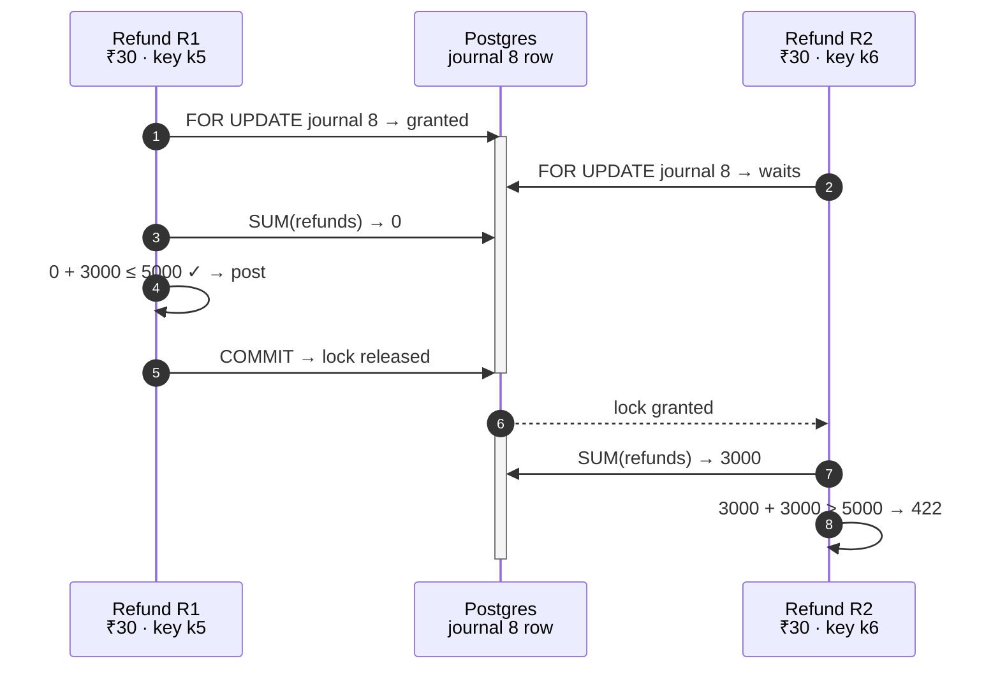

*R2 waits at the journal lock, so its SUM runs after R1 has committed. Without that lock both would read 0, both would pass, and ₹60 would be refunded on a ₹50 transfer.* Activation bars: R1 holds it (steps 1–5); R2 holds it (steps 6–8).

| # | Step | What happens | Code | Can fail with |
|---|---|---|---|---|
| 1 | R1 locks journal 8 |  | [LedgerRepository.java:52](../src/main/java/com/hirdesh/wallet/ledger/LedgerRepository.java#L52) |  |
| 2 | R2 queues behind R1 | R2 is blocked inside Postgres until R1's transaction ends. |  |  |
| 3 | R1 reads the total so far |  | [LedgerRepository.java:57](../src/main/java/com/hirdesh/wallet/ledger/LedgerRepository.java#L57) |  |
| 4 | R1 passes and posts its refund |  | [CorrectionOperations.java:57](../src/main/java/com/hirdesh/wallet/wallet/CorrectionOperations.java#L57) |  |
| 5 | R1 commits |  |  |  |
| 6 | R2 wakes up |  |  |  |
| 7 | R2 sees R1's refund | A fresh statement after the lock, so it reads the latest committed data. |  |  |
| 8 | R2 is rejected | REFUND_EXCEEDS_ORIGINAL. Tx2 rolls back, and the 422 is stored for key k6 so a retry gets the same answer. |  | `422 REFUND_EXCEEDS_ORIGINAL` total would be ₹60 |

### Database before and after

| Row | Before | After |
|---|---|---|
| accounts · id 2 alice | −2000 | −4000 (₹40) |
| accounts · id 3 bob | −5000 | −3000 (₹30) |
| journals · id 8 (the transfer) | TRANSFER 5000 | unchanged (append-only) |
| journals | — | + id 10 · REFUND · 2000 · reference 8 · key k4 |
| postings | — | + (10, account 3, +2000) · (10, account 2, −2000) |

₹30 of journal 8 is still refundable. The M5 invariant job adds check 5, `REFUNDS_WITHIN_ORIGINAL`, because an over-refund still balances perfectly as double-entry and checks 1–4 would not notice it.

---

## Reversal

**Alice's ₹30 bank payout bounced.** A reversal fully undoes a top-up (a card chargeback) or a withdrawal (a payout the bank sent back). It is a new journal whose postings are the original's with every sign flipped, and each original can be reversed only once.

- **Endpoint:** `POST /api/v1/journals/{journalId}/reversals`
- **Request fingerprint:** `REVERSAL | journalId`
- **Rows locked:** `journal 9, then pool (1), then Alice (2)`
- **Journal written:** `REVERSAL ref 9: Alice −3000, pool +3000`

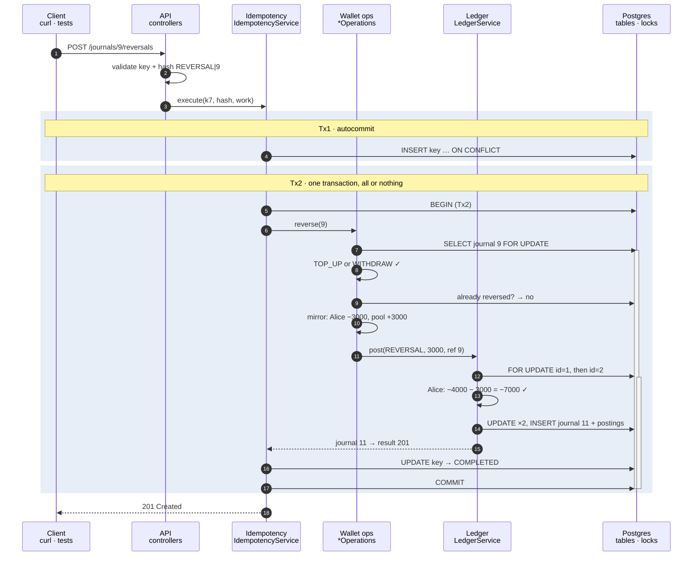

*"Only once" is enforced twice: by the check under the journal lock (step 9), and by a unique index in Postgres (step 14) that holds even if the code is wrong.* Activation bars: journal 9 (steps 7–17); pool + Alice (steps 12–17).

| # | Step | What happens | Code | Can fail with |
|---|---|---|---|---|
| 1 | Client asks for a reversal | No amount: a reversal always undoes the whole journal. Journal 9 is Alice's ₹30 withdrawal. Key k7. | [JournalController.java:61](../src/main/java/com/hirdesh/wallet/api/JournalController.java#L61) |  |
| 2 | Validate and fingerprint |  | [RequestValidator.java:41](../src/main/java/com/hirdesh/wallet/api/RequestValidator.java#L41)<br>[RequestHasher.java:22](../src/main/java/com/hirdesh/wallet/idempotency/RequestHasher.java#L22) | `400 IDEMPOTENCY_KEY_MISSING` no header |
| 3 | Hand over to idempotency |  | [IdempotencyService.java:59](../src/main/java/com/hirdesh/wallet/idempotency/IdempotencyService.java#L59) |  |
| 4 | Tx1: claim k7 |  | [IdempotencyRepository.java:23](../src/main/java/com/hirdesh/wallet/idempotency/IdempotencyRepository.java#L23) |  |
| 5 | Tx2 begins |  | [IdempotencyService.java:96](../src/main/java/com/hirdesh/wallet/idempotency/IdempotencyService.java#L96) |  |
| 6 | Run the reversal |  | [CorrectionOperations.java:72](../src/main/java/com/hirdesh/wallet/wallet/CorrectionOperations.java#L72) |  |
| 7 | Lock the original withdrawal | Serializes every reversal attempt on journal 9 and loads its postings. | [CorrectionOperations.java:73](../src/main/java/com/hirdesh/wallet/wallet/CorrectionOperations.java#L73)<br>[LedgerRepository.java:52](../src/main/java/com/hirdesh/wallet/ledger/LedgerRepository.java#L52) | `404 JOURNAL_NOT_FOUND` no journal 9 |
| 8 | Is it reversible? | Transfers are corrected with refunds instead, and refunds and reversals themselves can't be reversed. | [CorrectionOperations.java:76](../src/main/java/com/hirdesh/wallet/wallet/CorrectionOperations.java#L76) | `422 NOT_REVERSIBLE` a transfer, refund or reversal |
| 9 | Has journal 9 been reversed? |  | [CorrectionOperations.java:79](../src/main/java/com/hirdesh/wallet/wallet/CorrectionOperations.java#L79)<br>[LedgerRepository.java:66](../src/main/java/com/hirdesh/wallet/ledger/LedgerRepository.java#L66) | `422 ALREADY_REVERSED` a reversal exists |
| 10 | Flip every posting | Journal 9 was Alice +3000, pool −3000. The reversal is its exact mirror, so per account the two journals cancel out. | [CorrectionOperations.java:84](../src/main/java/com/hirdesh/wallet/wallet/CorrectionOperations.java#L84) |  |
| 11 | Ledger takes over |  | [CorrectionOperations.java:88](../src/main/java/com/hirdesh/wallet/wallet/CorrectionOperations.java#L88)<br>[LedgerService.java:35](../src/main/java/com/hirdesh/wallet/ledger/LedgerService.java#L35) |  |
| 12 | Lock pool, then Alice |  | [PessimisticLocking.java:25](../src/main/java/com/hirdesh/wallet/ledger/locking/PessimisticLocking.java#L25) | `503 TRY_AGAIN` waited more than 5s |
| 13 | Funds check | Undoing a withdrawal gives money back, so it passes. Undoing a top-up (a chargeback) takes money away, and fails if Alice has already spent it. | [LedgerService.java:54](../src/main/java/com/hirdesh/wallet/ledger/LedgerService.java#L54) | `422 INSUFFICIENT_FUNDS` a chargeback the wallet can't cover |
| 14 | Write; the unique index checks "once" | `journals_one_reversal_idx` allows one REVERSAL row per original. A second one fails with SQLState 23505, which Spring raises as `DuplicateKeyException` and the code turns into ALREADY_REVERSED. In the M4 experiment this index alone kept 10 parallel reversals down to 1, even with the journal lock removed. | [V2__ledger.sql:18](../src/main/resources/db/migration/V2__ledger.sql#L18)<br>[CorrectionOperations.java:90](../src/main/java/com/hirdesh/wallet/wallet/CorrectionOperations.java#L90) | `422 ALREADY_REVERSED` unique index backstop |
| 15 | Return the result |  | [WalletController.java:92](../src/main/java/com/hirdesh/wallet/api/WalletController.java#L92) |  |
| 16 | Mark k7 done (fencing check) |  | [IdempotencyRepository.java:67](../src/main/java/com/hirdesh/wallet/idempotency/IdempotencyRepository.java#L67) |  |
| 17 | Commit Tx2 | Releases the journal lock and both account locks. |  |  |
| 18 | Respond |  | [IdempotentResponses.java:16](../src/main/java/com/hirdesh/wallet/api/IdempotentResponses.java#L16) |  |

<details>
<summary>SQL run in this flow</summary>

**Step 9: Has journal 9 been reversed?**

```sql
SELECT EXISTS (SELECT 1 FROM journals
              WHERE reference_journal_id = 9 AND type = 'REVERSAL');
```

**Step 14: Write; the unique index checks "once"**

```sql
UPDATE accounts SET balance = balance + 3000 WHERE id = 1;
UPDATE accounts SET balance = balance - 3000 WHERE id = 2;
INSERT INTO journals (type, amount, reference_journal_id, idempotency_key)
VALUES ('REVERSAL', 3000, 9, 'k7') RETURNING id;   -- 11
INSERT INTO postings VALUES (…, 11, 1, 3000), (…, 11, 2, -3000);
```

</details>

### Database before and after

| Row | Before | After |
|---|---|---|
| accounts · id 1 CASH_POOL | 7000 | 10000 |
| accounts · id 2 alice | −4000 | −7000 (₹70) |
| journals · id 9 (the withdrawal) | WITHDRAW 3000 | unchanged (append-only) |
| journals | — | + id 11 · REVERSAL · 3000 · reference 9 · key k7 |
| postings | — | + (11, account 1, +3000) · (11, account 2, −3000) |

Check: Alice ₹70 + Bob ₹30 = ₹100 = the pool. Raw −7000 − 3000 + 10000 = 0.

---

## Idempotency

**one key, at most one money movement.** Every money request carries an Idempotency-Key. One row in `idempotency_keys` per key records whether the request ran, who is running it, and what it answered. The rules below are what make retries safe.

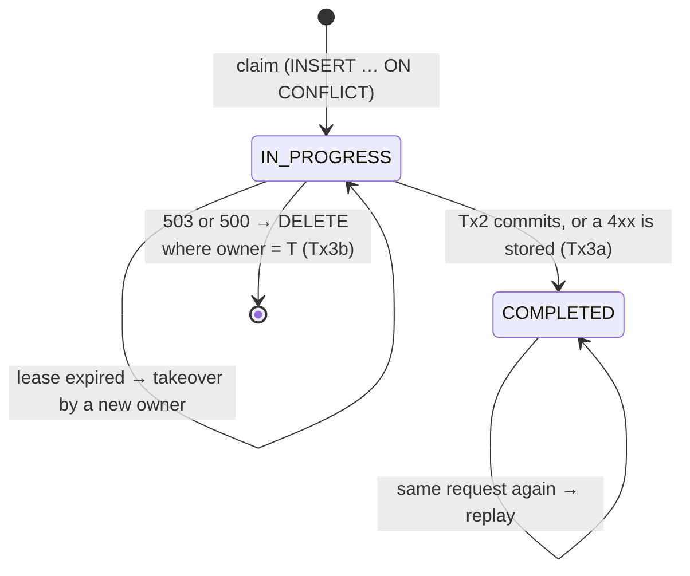

### What the claim finds, and what happens

| Existing row for the key | Result | Code |
|---|---|---|
| None: the INSERT succeeds | This request owns the key and runs Tx2 | `idempotency/IdempotencyService.java:131` |
| Different fingerprint | 409 IDEMPOTENCY_KEY_REUSED | `idempotency/IdempotencyService.java:138` |
| COMPLETED, same fingerprint | Stored status and body, header `Idempotent-Replayed: true` | `idempotency/IdempotencyService.java:142` |
| IN_PROGRESS, lease still running | 409 REQUEST_IN_PROGRESS | `idempotency/IdempotencyService.java:145` |
| IN_PROGRESS, lease expired | Take over with a new token, then run Tx2 | `idempotency/IdempotencyService.java:149` |
| Deleted between the INSERT and the SELECT | Claim again (at most 3 rounds) | `idempotency/IdempotencyService.java:129` |

### How Tx2 ends decides what a retry gets

| Tx2 outcome | Key afterwards | Retry with the same key |
|---|---|---|
| Success, 201 | COMPLETED with the body (same transaction as the money) | Replays the 201 |
| Business error, 404 or 422 | COMPLETED with the error body (Tx3a, `IdempotencyService.java:75`) | Replays the same error, even if it would succeed now |
| 503 or 500 | Row deleted (Tx3b, `IdempotencyService.java:78` and `:83`) | Runs again from scratch |
| 400, rejected before the claim | Never created | Runs normally |

### A retry after the first response was lost

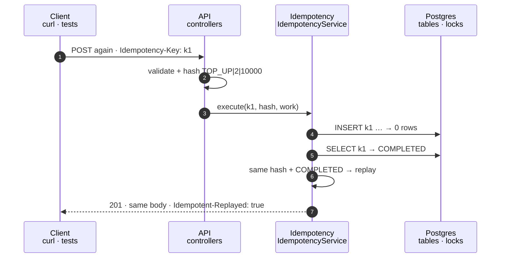

*The retry never opens a transaction or takes a lock. Two SQL statements decide it, and the client gets the original bytes back.*

| # | Step | What happens | Code | Can fail with |
|---|---|---|---|---|
| 1 | The client retries | The first 201 got lost on the network, so the client sends the identical top-up again. |  |  |
| 2 | Same fingerprint as before |  | [RequestHasher.java:22](../src/main/java/com/hirdesh/wallet/idempotency/RequestHasher.java#L22) |  |
| 3 | Into idempotency |  | [IdempotencyService.java:59](../src/main/java/com/hirdesh/wallet/idempotency/IdempotencyService.java#L59) |  |
| 4 | The claim does nothing: k1 exists |  | [IdempotencyRepository.java:23](../src/main/java/com/hirdesh/wallet/idempotency/IdempotencyRepository.java#L23) |  |
| 5 | Read the existing row | The lease expiry is computed with the database clock, never the app's clock. | [IdempotencyRepository.java:35](../src/main/java/com/hirdesh/wallet/idempotency/IdempotencyRepository.java#L35) |  |
| 6 | Decide: replay |  | [IdempotencyService.java:138](../src/main/java/com/hirdesh/wallet/idempotency/IdempotencyService.java#L138)<br>[IdempotencyService.java:142](../src/main/java/com/hirdesh/wallet/idempotency/IdempotencyService.java#L142) |  |
| 7 | Return the stored answer | No Tx2, no locks, no journal: the money moved exactly once. | [IdempotentResponses.java:20](../src/main/java/com/hirdesh/wallet/api/IdempotentResponses.java#L20) |  |

<details>
<summary>SQL run in this flow</summary>

**Step 5: Read the existing row**

```sql
SELECT key, request_hash, status, (locked_until < now()) AS lease_expired,
       response_status, response_body
FROM idempotency_keys WHERE key = 'k1';
```

</details>

### Two identical requests at the same instant (S-21)

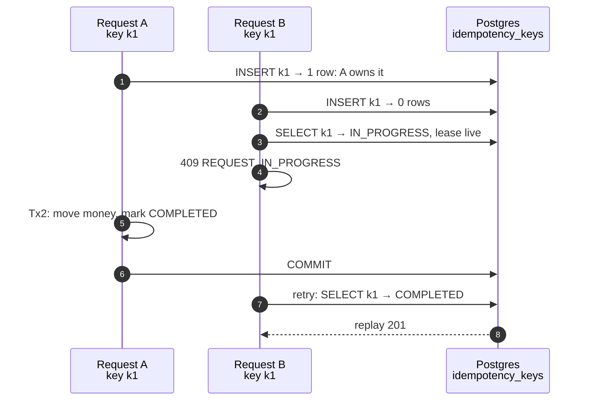

*The primary key on idempotency_keys picks the winner; Java never decides. In the S-21 test, out of 20 identical requests 1 moved money, 11–13 were replays and 6–8 got 409.*

| # | Step | What happens | Code | Can fail with |
|---|---|---|---|---|
| 1 | A wins the claim | Both INSERTs race on the same primary key. Postgres lets exactly one succeed; the other waits for it and then does nothing (ON CONFLICT DO NOTHING). | [IdempotencyRepository.java:23](../src/main/java/com/hirdesh/wallet/idempotency/IdempotencyRepository.java#L23) |  |
| 2 | B loses the claim |  |  |  |
| 3 | B looks at the row |  | [IdempotencyRepository.java:35](../src/main/java/com/hirdesh/wallet/idempotency/IdempotencyRepository.java#L35) |  |
| 4 | B is told to come back later | Immediate answer; B doesn't hold a connection while A works. | [IdempotencyService.java:145](../src/main/java/com/hirdesh/wallet/idempotency/IdempotencyService.java#L145) | `409 REQUEST_IN_PROGRESS` A is still running |
| 5 | A does the work | Locks, journal, postings and the COMPLETED row, as in [Top-up](#top-up). |  |  |
| 6 | A commits |  |  |  |
| 7 | B retries later | Same key, same body. |  |  |
| 8 | B gets the stored result |  |  |  |

### A stalled owner, a takeover, and the fencing check

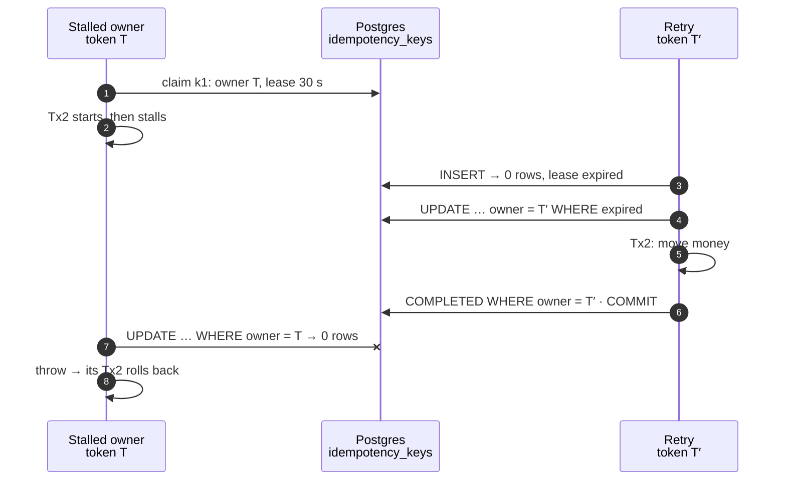

*The lease stops a crashed request from blocking a key forever. The owner token stops a stalled one from finishing after it was replaced. Together they keep it to exactly one money movement.*

| # | Step | What happens | Code | Can fail with |
|---|---|---|---|---|
| 1 | The first request claims the key |  | [IdempotencyRepository.java:23](../src/main/java/com/hirdesh/wallet/idempotency/IdempotencyRepository.java#L23) |  |
| 2 | It stalls | A long GC pause, a slow network, anything. If it already held account locks, the retry would simply wait for them; the ending is the same. |  |  |
| 3 | A retry arrives after 30 s |  | [IdempotencyService.java:145](../src/main/java/com/hirdesh/wallet/idempotency/IdempotencyService.java#L145) |  |
| 4 | The retry takes over | Only one taker can win: the WHERE re-checks the expiry on the row being updated. | [IdempotencyRepository.java:52](../src/main/java/com/hirdesh/wallet/idempotency/IdempotencyRepository.java#L52)<br>[IdempotencyService.java:149](../src/main/java/com/hirdesh/wallet/idempotency/IdempotencyService.java#L149) |  |
| 5 | The retry does the work |  |  |  |
| 6 | The retry completes and commits |  | [IdempotencyRepository.java:67](../src/main/java/com/hirdesh/wallet/idempotency/IdempotencyRepository.java#L67) |  |
| 7 | The stalled owner wakes up and tries to finish | Its fencing check matches nothing, because T no longer owns the key. | [IdempotencyService.java:99](../src/main/java/com/hirdesh/wallet/idempotency/IdempotencyService.java#L99) |  |
| 8 | Its money movement is undone | The money moved once, by the retry. The test `fencingTokenStopsAStaleOwnerFromCompleting` covers this. |  | `503 TRY_AGAIN` to the stalled request |

<details>
<summary>SQL run in this flow</summary>

**Step 4: The retry takes over**

```sql
UPDATE idempotency_keys
   SET owner_token = :T2, locked_until = now() + interval '30 seconds'
 WHERE key = 'k1' AND status = 'IN_PROGRESS' AND locked_until < now();
```

</details>

---

## Errors

**what fails, where, and what is left behind.** Every failure answers three questions: what the client gets, whether anything was written, and what a retry with the same key will do. Business failures (4xx) are final and stored; infrastructure failures (5xx) release the key so a retry can run again.

### A business failure: Alice tries to send ₹500 with ₹70

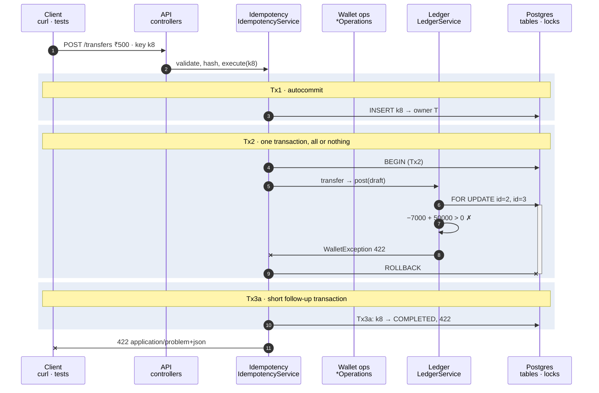

*The ledger throws inside Tx2, so Tx2 rolls back and writes nothing. A separate short transaction (Tx3a) then stores the 422 under the key, so the answer for k8 never changes.* Activation bars: Alice + Bob locked (steps 6–9).

| # | Step | What happens | Code | Can fail with |
|---|---|---|---|---|
| 1 | A transfer Alice can't afford | Alice has ₹70 (raw −7000). Amount 50000. | [TransferController.java:35](../src/main/java/com/hirdesh/wallet/api/TransferController.java#L35) |  |
| 2 | Input is valid, so the key gets claimed |  | [IdempotencyService.java:59](../src/main/java/com/hirdesh/wallet/idempotency/IdempotencyService.java#L59) |  |
| 3 | Tx1: claim k8 |  |  |  |
| 4 | Tx2 begins |  |  |  |
| 5 | Recipe, then the ledger |  | [WalletOperations.java:54](../src/main/java/com/hirdesh/wallet/wallet/WalletOperations.java#L54)<br>[LedgerService.java:35](../src/main/java/com/hirdesh/wallet/ledger/LedgerService.java#L35) |  |
| 6 | Lock both wallets |  |  |  |
| 7 | The funds check fails |  | [LedgerService.java:54](../src/main/java/com/hirdesh/wallet/ledger/LedgerService.java#L54) | `422 INSUFFICIENT_FUNDS` Alice has ₹70 |
| 8 | The exception travels up | It leaves the Tx2 lambda, so `TransactionTemplate` rolls the transaction back. | [IdempotencyService.java:71](../src/main/java/com/hirdesh/wallet/idempotency/IdempotencyService.java#L71) |  |
| 9 | Tx2 is undone | Locks released. No balance, journal or posting was written. |  |  |
| 10 | Store the business outcome | A 4xx is the final answer for this key. Retrying k8 returns the same 422 even after Alice tops up; a fresh attempt needs a new key. | [IdempotencyService.java:73](../src/main/java/com/hirdesh/wallet/idempotency/IdempotencyService.java#L73)<br>[IdempotencyService.java:75](../src/main/java/com/hirdesh/wallet/idempotency/IdempotencyService.java#L75) |  |
| 11 | Respond | Returned by the idempotency layer rather than `ApiExceptionHandler`, so the first answer and every replay are the same bytes. | [IdempotentResponses.java:16](../src/main/java/com/hirdesh/wallet/api/IdempotentResponses.java#L16) |  |

### An infrastructure failure: waiting too long for a lock

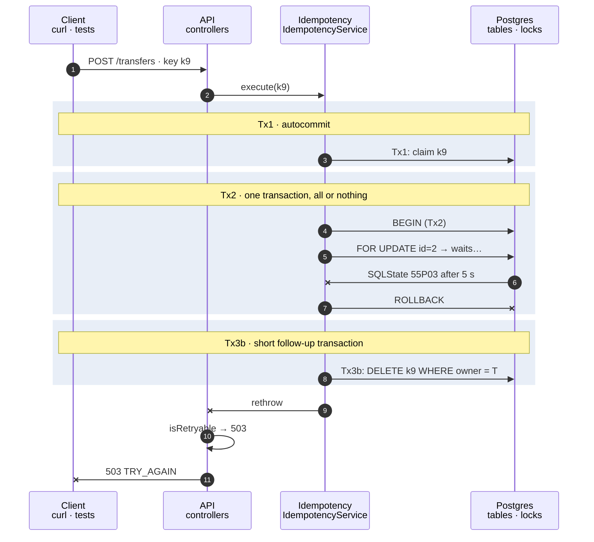

*The key is deleted instead of stored, because "the database was busy" says nothing about whether the request should succeed. The client retries with the same key and the request runs again from scratch.*

| # | Step | What happens | Code | Can fail with |
|---|---|---|---|---|
| 1 | A transfer arrives while Alice is busy |  |  |  |
| 2 | Validated and handed over |  |  |  |
| 3 | Claim the key |  |  |  |
| 4 | Tx2 begins |  |  |  |
| 5 | Another transaction holds Alice's row |  |  |  |
| 6 | lock_timeout fires | Spring raises this as `UncategorizedSQLException`, not as a locking exception. The M3 experiment caught that: it used to come back as a 500. | [application.yml:14](../src/main/resources/application.yml#L14) |  |
| 7 | Tx2 is undone |  |  |  |
| 8 | Release the key |  | [IdempotencyService.java:80](../src/main/java/com/hirdesh/wallet/idempotency/IdempotencyService.java#L80)<br>[IdempotencyService.java:83](../src/main/java/com/hirdesh/wallet/idempotency/IdempotencyService.java#L83)<br>[IdempotencyRepository.java:83](../src/main/java/com/hirdesh/wallet/idempotency/IdempotencyRepository.java#L83) |  |
| 9 | The exception reaches the API layer |  |  |  |
| 10 | Map it to 503 | Walks the cause chain for SQLState 40P01, 55P03 or 40001, or for a connection-pool timeout. | [ApiExceptionHandler.java:59](../src/main/java/com/hirdesh/wallet/api/ApiExceptionHandler.java#L59)<br>[ApiExceptionHandler.java:71](../src/main/java/com/hirdesh/wallet/api/ApiExceptionHandler.java#L71) |  |
| 11 | Tell the client to retry with the same key |  |  | `503 TRY_AGAIN` temporary; safe to retry |

### Every failure in one table

| Failure | Raised at | Client gets | Database | Key afterwards |
|---|---|---|---|---|
| Missing or bad input | `api/RequestValidator.java`, `ApiExceptionHandler.java:54` | 400 VALIDATION_FAILED · IDEMPOTENCY_KEY_MISSING | untouched | never claimed |
| Same key, different request | `IdempotencyService.java:138` | 409 IDEMPOTENCY_KEY_REUSED | untouched | unchanged |
| Same key still running | `IdempotencyService.java:145` | 409 REQUEST_IN_PROGRESS | untouched | unchanged |
| Wallet or journal not found | `WalletOperations.java:68`, `CorrectionOperations.java:97` | 404 | Tx2 rolled back | COMPLETED with the 404 |
| Business rule: funds, refund limit, not refundable or reversible, already reversed | `LedgerService.java:54`, `CorrectionOperations.java:50–90` | 422 | Tx2 rolled back | COMPLETED with the 422 |
| Lock wait over 5 s, deadlock, serialization failure, no free connection | Postgres or the pool, mapped in `ApiExceptionHandler.java:71` | 503 TRY_AGAIN | rolled back | deleted: a retry runs again |
| Optimistic conflict on all 10 attempts | `IdempotencyService.java:106` | 503 TRY_AGAIN | every attempt rolled back | deleted |
| Lost key ownership (fencing) | `IdempotencyService.java:99` | 503 TRY_AGAIN | rolled back | belongs to the other request |
| Bug: invalid draft, or a DB guard fires | `JournalDraft.java:18`, `V3__ledger_guards.sql` | 500 INTERNAL_ERROR | rolled back | deleted |

---

## Concurrency

**two transfers hit the same wallet.** Alice has ₹100 and two ₹80 transfers arrive together. Without protection both read ₹100, both pass the funds check, and ₹160 leaves a ₹100 wallet. Here is how each strategy closes that gap, and why the order of locks matters.

### Pessimistic locking (the default): the second one waits

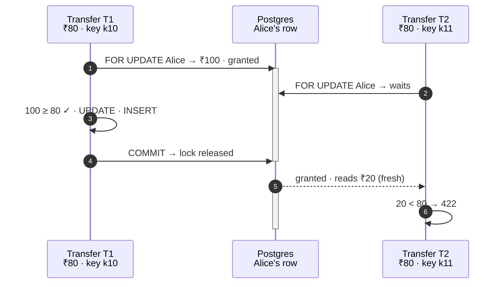

*T2 cannot even read the balance for its decision until T1 commits, so it decides on fresh data. Plain SELECTs from other readers are never blocked (MVCC).* Activation bars: T1 holds it (steps 1–4); T2 holds it (steps 5–6).

| # | Step | What happens | Code | Can fail with |
|---|---|---|---|---|
| 1 | T1 locks Alice |  | [PessimisticLocking.java:25](../src/main/java/com/hirdesh/wallet/ledger/locking/PessimisticLocking.java#L25)<br>[AccountRepository.java:49](../src/main/java/com/hirdesh/wallet/account/AccountRepository.java#L49) |  |
| 2 | T2 has to wait | T2 blocks inside Postgres, holding its connection, for up to 5 seconds (lock_timeout). |  |  |
| 3 | T1 checks and writes |  | [LedgerService.java:54](../src/main/java/com/hirdesh/wallet/ledger/LedgerService.java#L54) |  |
| 4 | T1 commits |  |  |  |
| 5 | T2 gets the lock and the new balance |  |  |  |
| 6 | T2 is correctly rejected |  |  | `422 INSUFFICIENT_FUNDS` only ₹20 left |

### Optimistic locking (wallet.ledger.locking=OPTIMISTIC): the second one retries

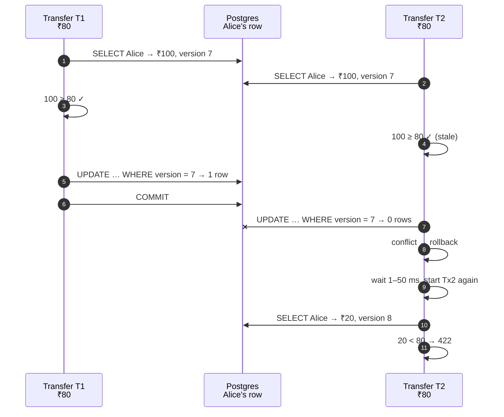

*Both decide on stale data, but the version check refuses to apply the stale decision. T2 rolls back, waits a moment, and redoes everything from a fresh read.*

| # | Step | What happens | Code | Can fail with |
|---|---|---|---|---|
| 1 | T1 reads without a lock |  | [OptimisticLocking.java:26](../src/main/java/com/hirdesh/wallet/ledger/locking/OptimisticLocking.java#L26) |  |
| 2 | T2 reads the same version |  |  |  |
| 3 | T1 passes the funds check |  |  |  |
| 4 | T2 passes too, on stale data |  |  |  |
| 5 | T1 writes, version becomes 8 |  | [OptimisticLocking.java:35](../src/main/java/com/hirdesh/wallet/ledger/locking/OptimisticLocking.java#L35)<br>[AccountRepository.java:69](../src/main/java/com/hirdesh/wallet/account/AccountRepository.java#L69) |  |
| 6 | T1 commits |  |  |  |
| 7 | T2's write matches nothing | If T1 had not committed yet, this UPDATE would wait for it, then re-check the WHERE against the committed row, so a stale version always gets 0 rows. |  |  |
| 8 | T2 throws and rolls back |  | [OptimisticLocking.java:39](../src/main/java/com/hirdesh/wallet/ledger/locking/OptimisticLocking.java#L39)<br>[IdempotencyService.java:106](../src/main/java/com/hirdesh/wallet/idempotency/IdempotencyService.java#L106) |  |
| 9 | Back off and retry the whole operation | Up to 10 attempts with a growing random pause; then 503. Under the 100-transfer test 11–28% of requests ran out of attempts. | [IdempotencyService.java:118](../src/main/java/com/hirdesh/wallet/idempotency/IdempotencyService.java#L118)<br>[application.yml:23](../src/main/resources/application.yml#L23) |  |
| 10 | T2 reads fresh data |  |  |  |
| 11 | T2 is correctly rejected |  |  | `422 INSUFFICIENT_FUNDS` only ₹20 left |

<details>
<summary>SQL run in this flow</summary>

**Step 5: T1 writes, version becomes 8**

```sql
UPDATE accounts SET balance = balance + 8000, version = version + 1
WHERE id = 2 AND version = 7;
```

</details>

### Why the lock order matters: locks taken sender-first

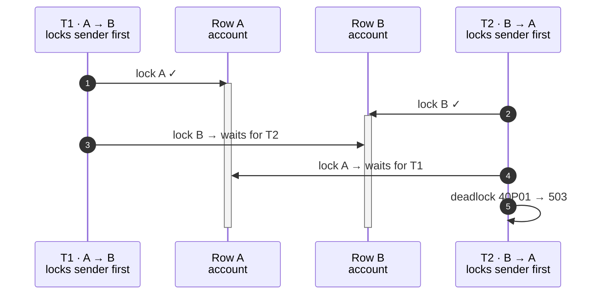

*Each transaction holds one row and waits for the other: a cycle. Postgres notices after about a second and kills one. The M3 experiment measured 80–90% of requests failing this way.* Activation bars: T1 (steps 1–5); T2 (steps 2–5).

| # | Step | What happens | Code | Can fail with |
|---|---|---|---|---|
| 1 | T1 locks its sender, A |  |  |  |
| 2 | T2 locks its sender, B |  |  |  |
| 3 | T1 needs B |  |  |  |
| 4 | T2 needs A: a cycle |  |  |  |
| 5 | Postgres kills one of them | This is the broken "unordered" strategy, which exists only in the test sources. |  | `503 TRY_AGAIN` deadlock victim |

### The fix in our code: everyone locks the lower id first

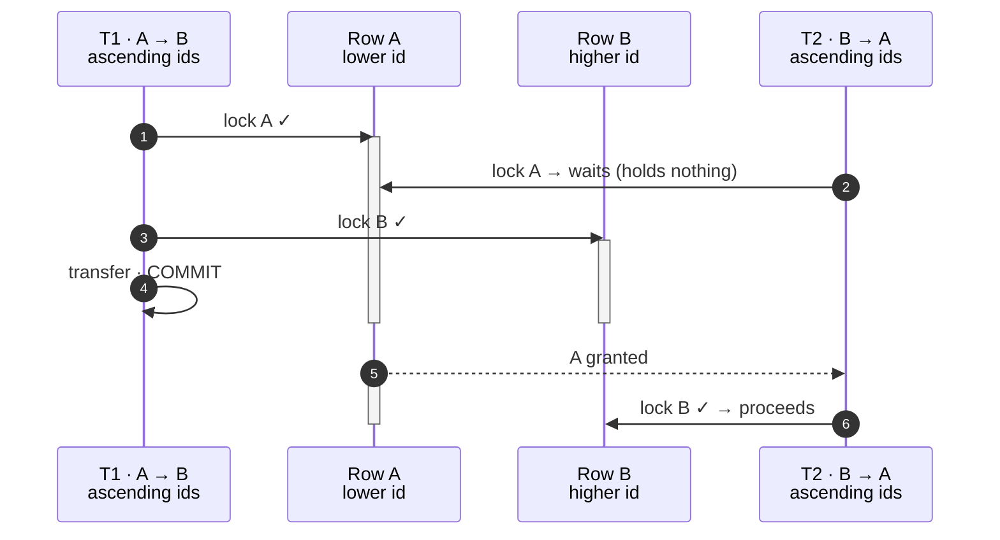

*Both transactions start with row A. Whoever loses waits at its first lock while holding nothing, so a cycle cannot form. This is the TreeMap in LedgerService.post.* Activation bars: T1 (steps 1–4); T1 (steps 3–4); T2 (steps 5–6).

| # | Step | What happens | Code | Can fail with |
|---|---|---|---|---|
| 1 | T1 locks A |  | [LedgerService.java:43](../src/main/java/com/hirdesh/wallet/ledger/LedgerService.java#L43) |  |
| 2 | T2 also starts with A, and waits |  |  |  |
| 3 | T1 locks B: nobody is in its way |  |  |  |
| 4 | T1 finishes and releases both rows |  |  |  |
| 5 | T2 gets A |  |  |  |
| 6 | T2 gets B and completes |  |  |  |

### What the M3 experiment measured (100 parallel requests)

| Strategy | 100 × ₹1 from a ₹100 wallet | 50 A→B + 50 B→A |
|---|---|---|
| No locking | 100 "succeeded", 73 updates lost | not run |
| Pessimistic, ascending ids (default) | 100 ok, ~250 ms | 100 ok, ~270 ms |
| Pessimistic, sender first | not run | 10–21 ok, 32–38 s |
| Optimistic, 10 attempts | 72–89 ok, the rest 503 | 70–88 ok, the rest 503 |

Full numbers and the decision are in `docs/adr/003-locking-strategy.md`.

---

## Reads and wallet creation

Reads never take locks, so they never wait for a transfer in progress: Postgres hands them the last committed version of each row (MVCC). Creating a wallet needs no idempotency key, because the unique user id already makes it safe to repeat.

### Get a balance: GET /wallets/2

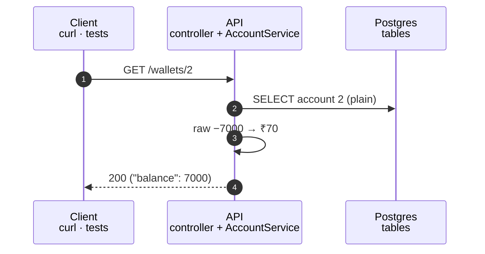

*One plain SELECT. If a transfer is holding Alice's row at this moment, the read returns her balance from before that transfer, because the transfer has not happened until it commits.*

| # | Step | What happens | Code | Can fail with |
|---|---|---|---|---|
| 1 | Client asks for the balance |  | [WalletController.java:56](../src/main/java/com/hirdesh/wallet/api/WalletController.java#L56) |  |
| 2 | No lock, never waits |  | [AccountService.java:37](../src/main/java/com/hirdesh/wallet/account/AccountService.java#L37)<br>[AccountRepository.java:31](../src/main/java/com/hirdesh/wallet/account/AccountRepository.java#L31) | `404 WALLET_NOT_FOUND` unknown id, or the pool |
| 3 | Flip the sign for people | A wallet is a liability, stored negative (ADR-001). The flip happens only here, at the API edge. | [Account.java:11](../src/main/java/com/hirdesh/wallet/account/Account.java#L11) |  |
| 4 | Respond |  |  |  |

<details>
<summary>SQL run in this flow</summary>

**Step 2: No lock, never waits**

```sql
SELECT id, type, user_id, code, balance, version FROM accounts WHERE id = 2;
```

</details>

### Transaction history: GET /wallets/2/transactions?limit=2

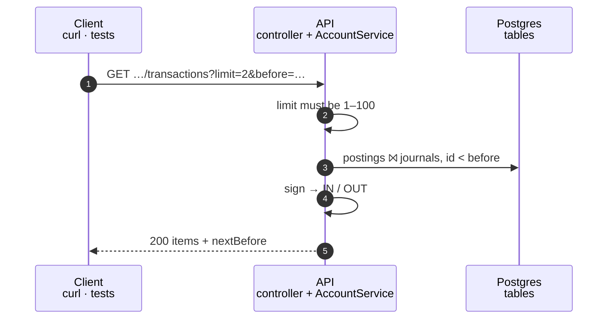

*Keyset pagination: each page asks for postings older than the last id it saw, so deep pages stay fast and new postings never shift a page.*

| # | Step | What happens | Code | Can fail with |
|---|---|---|---|---|
| 1 | Client asks for a page |  | [WalletController.java:61](../src/main/java/com/hirdesh/wallet/api/WalletController.java#L61) |  |
| 2 | Validate the page size |  | [RequestValidator.java:58](../src/main/java/com/hirdesh/wallet/api/RequestValidator.java#L58) | `400 VALIDATION_FAILED` limit out of range |
| 3 | Fetch one page | Served by the index `postings(account_id, id DESC)`. The first page uses `before = Long.MAX_VALUE`. | [AccountService.java:48](../src/main/java/com/hirdesh/wallet/account/AccountService.java#L48)<br>[V2__ledger.sql:29](../src/main/resources/db/migration/V2__ledger.sql#L29) |  |
| 4 | Translate signs into directions | A credit (−) to a wallet is money in for the user; a debit (+) is money out. |  |  |
| 5 | Respond | `nextBefore` is the last posting id when the page is full, otherwise null. |  |  |

<details>
<summary>SQL run in this flow</summary>

**Step 3: Fetch one page**

```sql
SELECT p.id, p.journal_id, j.type, p.amount, p.created_at
FROM postings p JOIN journals j ON j.id = p.journal_id
WHERE p.account_id = 2 AND p.id < :before
ORDER BY p.id DESC LIMIT 2;
```

</details>

### Create a wallet: POST /wallets

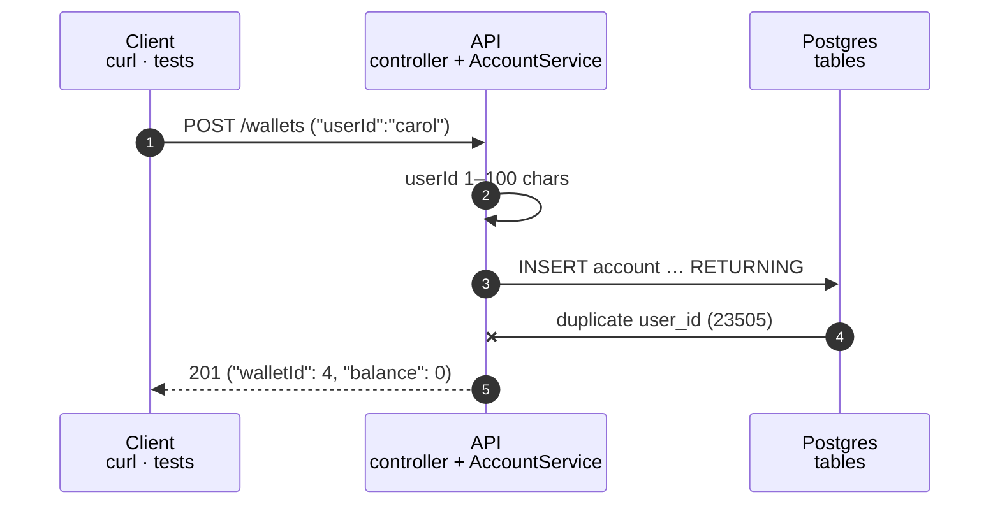

*No check-then-insert race: the UNIQUE constraint on user_id decides, and a duplicate becomes a clean 409.*

| # | Step | What happens | Code | Can fail with |
|---|---|---|---|---|
| 1 | Client creates a wallet |  | [WalletController.java:49](../src/main/java/com/hirdesh/wallet/api/WalletController.java#L49) |  |
| 2 | Validate |  | [RequestValidator.java:51](../src/main/java/com/hirdesh/wallet/api/RequestValidator.java#L51) | `400 VALIDATION_FAILED` blank or too long |
| 3 | Insert directly |  | [AccountService.java:29](../src/main/java/com/hirdesh/wallet/account/AccountService.java#L29)<br>[AccountRepository.java:24](../src/main/java/com/hirdesh/wallet/account/AccountRepository.java#L24) |  |
| 4 | If carol already has a wallet | Spring raises `DuplicateKeyException`, which becomes WALLET_EXISTS. | [AccountService.java:32](../src/main/java/com/hirdesh/wallet/account/AccountService.java#L32) | `409 WALLET_EXISTS` second wallet for the same user |
| 5 | Respond |  |  |  |

<details>
<summary>SQL run in this flow</summary>

**Step 3: Insert directly**

```sql
INSERT INTO accounts (type, user_id) VALUES ('USER_WALLET', 'carol')
RETURNING id, type, user_id, code, balance, version;
```

</details>
